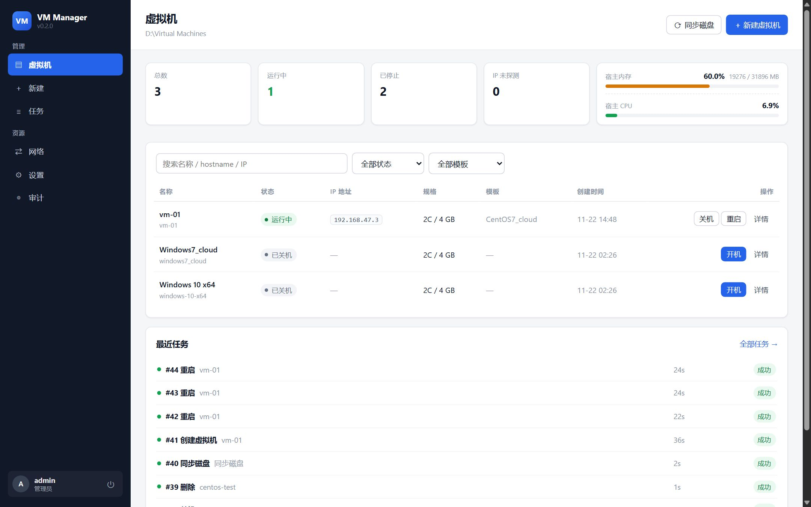
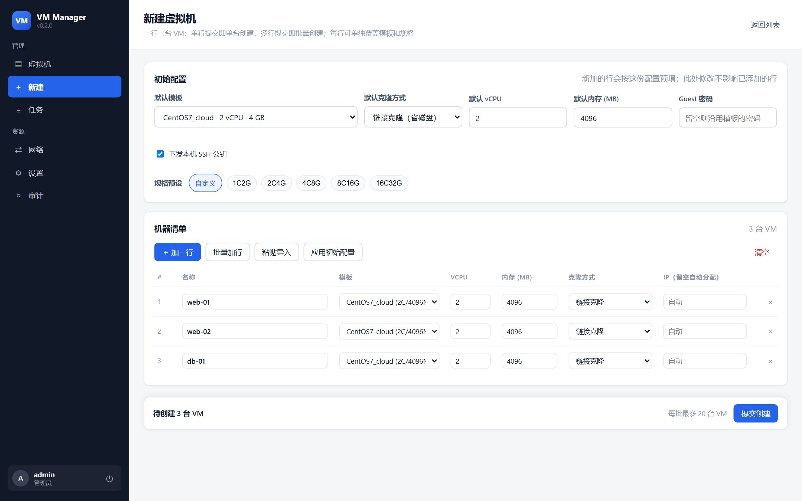
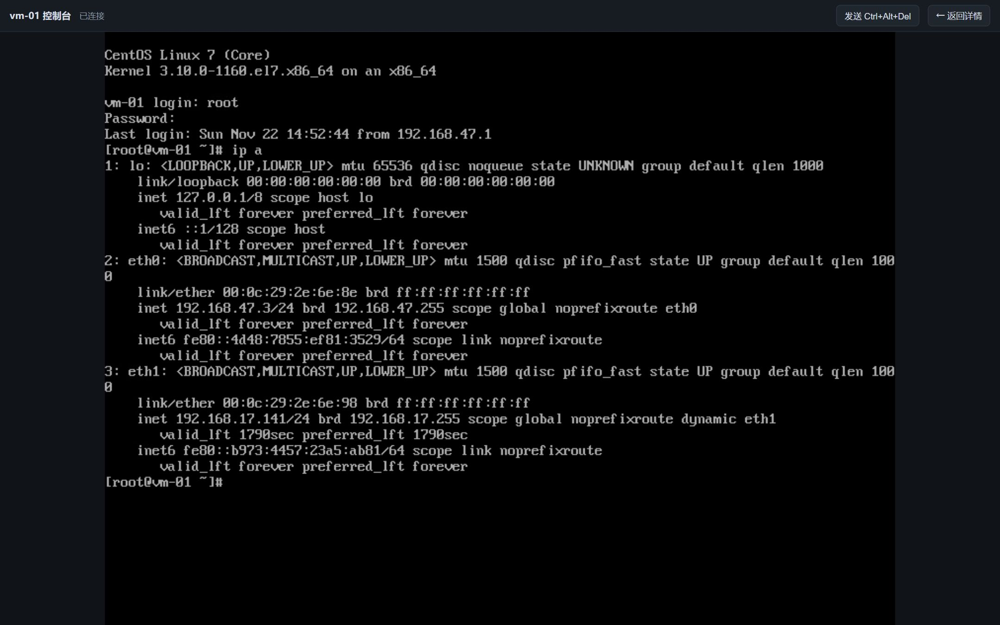
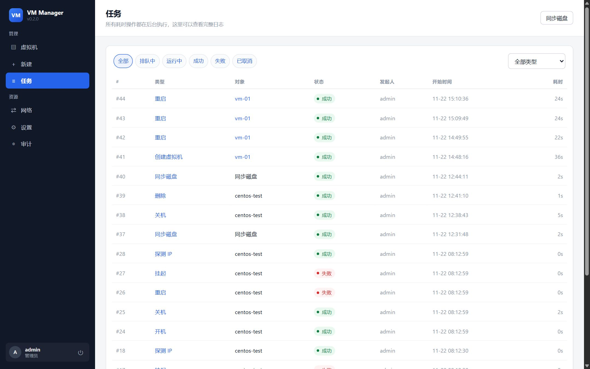
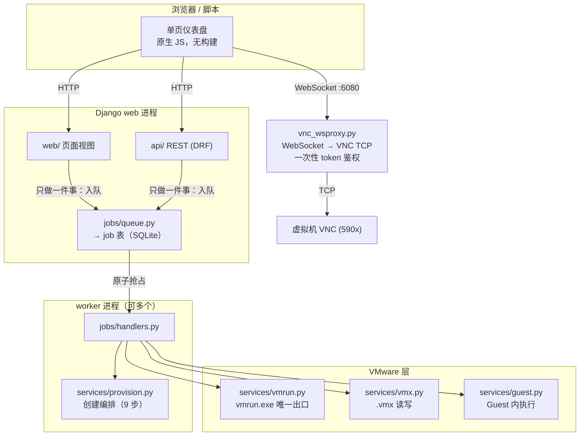

<div align="center">

# VM Manager

**Web-based management panel for VMware Workstation VMs — provision from a template, get a SSH-ready machine in seconds, control it from your browser.**

[](https://www.python.org/)
[](https://www.djangoproject.com/)
[](#开发)
[](LICENSE)
[](https://www.vmware.com/)

**选模板 → 选规格 → 点创建 → 30 秒后得到一台能 ssh 进去的虚拟机**
IP 已配好 · 主机名已改好 · 公钥已下发 · 全程不碰 VMware 图形界面

[功能一览](#功能) · [快速开始](#快速开始) · [截图](#截图) · [架构](#架构) · [故障排查](#故障排查)

</div>

---

## 为什么做这个

VMware Workstation 自带的 Web 控制台（WSX）在 16.x 被标记废弃、17.x 直接移除，
之后想远程管理本机虚拟机就只剩两条路：装 vCenter（面向 ESXi，不是 Workstation），
或者手动开图形界面。

GitHub 上现成的替代品基本都是脚本或玩具项目，缺少三样真正要紧的东西：

1. **一个可靠的后台任务队列**——克隆、开机、改 IP 都是分钟级操作，不能挂在 HTTP 请求里；
2. **不依赖 VMware Tools 的 IP 探测**——Tools 没起来时页面不该显示「IP 未知」；
3. **对跨平台 `vmrun` 各种坑的处理**——尤其是 `.vmx` 文件的编码、换行和键名大小写。

这个项目就是把这三点做扎实。

---

## 截图

| 仪表盘 | 批量创建 |
| --- | --- |
|  |  |

| noVNC 网页控制台 | 任务日志 |
| --- | --- |
|  |  |

控制台截图里就是浏览器里实时渲染的虚拟机屏幕——没有桌面系统的 Linux，
网页即命令行。

---

## 功能

| 功能 | 说明 |
| --- | --- |
| **模板 + 规格创建** | 链接克隆秒级完成，可指定 vCPU / 内存 / IP；支持表格化一次批量创建多台（每行可单独覆盖模板/规格） |
| **自动初始化** | 克隆后自动改主机名、配静态 IP、下发 SSH 公钥，产出即可 ssh |
| **noVNC 网页控制台** | 浏览器直连虚拟机屏幕（自带 token 鉴权的 WebSocket 代理，零第三方依赖），无桌面系统就是网页命令行 |
| **持久化任务队列** | 任务入库，worker 崩溃后能被其他 worker 接管，进度与日志实时可查、可取消 |
| **四种 IP 探测** | Tools → DHCP 租约 → ARP 按 MAC 匹配 → 扫网段，逐级兜底 |
| **电源与快照** | 开机 / 关机 / 强制断电 / 重启 / 挂起，快照创建 / 回滚 / 删除 |
| **批量操作** | 列表多选虚拟机，一键批量开机 / 关机 / 删除，逐台独立入队互不影响 |
| **调整规格与扩容** | 已有虚拟机改 vCPU / 内存（自动关机改 vmx 再开机）；磁盘扩容一步到位（`vmware-vdiskmanager` + Guest 内自动扩分区与文件系统） |
| **完整克隆** | `vmrun clone full` 复制整台虚拟机（含磁盘数据），与链接克隆一样自动完成初始化 |
| **OVF / OVA 导出** | 用 VMware 自带 `ovftool` 把虚拟机打包成可迁移的 `.ova`，进度实时写任务日志；未装 ovftool 时优雅降级 |
| **多用户配额** | 按账号限制虚拟机数量与内存总量，创建 / 克隆 / 批量入口统一拦截，设置页可视化管理 |
| **NAT 端口转发** | 在网页上增删宿主机端口到虚拟机端口的转发规则与 DHCP 静态绑定，改完自动重启 VMware 网络服务 |
| **资源趋势图** | 开启采集后 worker 定期进 Guest 采样 CPU / 内存，详情页时序曲线（分钟级粒度，依赖 open-vm-tools，仅 Linux Guest） |
| **任务完成通知** | 任务失败（或按配置成功也通知）推送到企业微信 / 钉钉群机器人或邮箱 |
| **任务重试** | 失败 / 已取消的任务一键按原参数重跑（新任务继承类型、参数与去重键，原任务日志保留） |
| **模板电源管理** | 模板同样是虚拟机，列表里直接开关机并标出运行状态 |
| **纳管已有虚拟机** | 扫描目录下所有 `.vmx`，自动读规格与网卡信息 |
| **网络与租约管理** | 自动推断 VMnet 网段，静态地址避开 DHCP 动态池 |
| **主机监控** | CPU / 内存实时读数，不依赖已被移除的 `wmic` |
| **审计日志** | 所有写操作留痕（谁、何时、对哪台机器做了什么） |
| **REST API** | `/api/v1/`，Token 认证，可脚本化 |
| **一条命令启动** | `python manage.py serve` 同时拉起 Web + worker + noVNC 代理 |

界面为中文单页式仪表盘（技术词保留英文），20 秒自动刷新，无前端构建步骤。

---

## 架构



**关键设计：不用 Celery。** 单机管理几十台虚拟机，引入 Redis + Celery 只会让部署
变成三件事而不是一件事。这里用数据库表当队列：

- 抢占靠一条原子的 `UPDATE ... WHERE status='queued'`，天然支持多 worker；
- worker 每 10 秒写心跳，超过 120 秒没心跳的任务会被别的 worker 回收重跑；
- 去重键（条件唯一索引）保证同一台机器不会被重复点两次开机。

代价是吞吐上限不高（几百任务/分钟），对家用和小团队完全够用。

**noVNC 控制台：** Web 进程给浏览器签发一次性 token 文件（TTL 300 秒，用完即毁），
`vnc_wsproxy` 校验 token 后把 WebSocket 连接桥接到虚拟机的 VNC 端口。
代理是纯标准库实现的 RFC 6455，不依赖 websockify（它在部分 Python 版本上静默失败）。

### 目录结构

```
vm_manager/
├── config/
│   ├── settings/
│   │   ├── base.py            # 统一配置：config.ini → .env → 环境变量
│   │   ├── dev.py             # DEBUG=True，静态文件由 Django 直供
│   │   └── prod.py            # 安全项收紧，读 ALLOWED_HOSTS
│   └── urls.py
├── vmmanager/
│   ├── models/                # base / catalog / machine / job / network / audit
│   ├── services/              # 纯业务逻辑，不依赖 HTTP
│   │   ├── vmrun.py           # vmrun.exe 唯一出口（编码、超时、跨平台）
│   │   ├── vmx.py             # .vmx 读写（大小写 / 编码 / CRLF 三个坑）
│   │   ├── guest.py           # Guest 内执行：主机名 / IP / 公钥
│   │   ├── network.py         # 探测、分配、VMnet 网段解析
│   │   ├── provision.py       # 创建编排（9 步）
│   │   ├── vnc.py             # VNC 配置写入 / 端口探测 / token 签发
│   │   ├── power.py  snapshot.py  inventory.py  metrics.py
│   ├── jobs/                  # 队列、worker、任务处理器
│   ├── vnc_wsproxy.py         # 纯标准库 WebSocket→VNC 桥
│   ├── web/                   # 页面视图、表单、中间件
│   ├── api/                   # DRF 序列化器与视图
│   ├── management/commands/   # serve / worker / vncproxy / bootstrap / sync_vms
│   └── tests/                 # 单元测试（244 个）
├── templates/                 # 服务端渲染，无前端构建
├── static/                    # 手写 CSS + 原生 JS + vendored noVNC
├── deploy/                    # systemd unit / Windows 服务说明
├── docs/screenshots/          # README 截图
└── data/                      # SQLite 与密钥（已 gitignore）
```

---

## 环境要求

| 项 | 要求 |
| --- | --- |
| 宿主机 | Windows 10/11、Linux 或 macOS（装了 VMware Workstation / Player / Fusion） |
| Python | 3.12+（Django 6.x 的最低要求） |
| 模板母机 | 建议 CentOS 7 / Rocky / Ubuntu 等装了 `open-vm-tools` 的 Linux，并已关机 |
| 权限 | 能执行 `vmrun`，且有权读写虚拟机目录 |

模板母机还需要满足：

1. `open-vm-tools` 服务在运行（改主机名 / 配 IP 依赖 Guest Operations）；
2. 有一个可登录的管理员账号（默认 `root`）；
3. 已打一个关机状态的快照（默认名 `init`），链接克隆会基于它。

---

## 快速开始

```bash
git clone https://github.com/<you>/vm_manager.git
cd vm_manager

python -m venv .venv
# Windows
.venv\Scripts\activate
# Linux / macOS
source .venv/bin/activate

pip install -r requirements.txt

# 1. 改配置：至少填 BASE_DIR / SRC_VMX / SNAPSHOT / ROOTPASS
copy config.example.ini config.ini      # Linux/macOS 用 cp
notepad config.ini

# 2. 建库 + 初始化
python manage.py migrate
python manage.py bootstrap

# 3. 一条命令同时启动 Web + worker + noVNC 代理
python manage.py serve
```

打开 <http://127.0.0.1:8000>，用 `bootstrap` 打印的账号登录。

> `serve` 会在同一窗口拉起三个组件，Ctrl+C 一起退出。
> 也可以分开跑：`runserver`（Web）+ `worker`（后台任务）+ `vncproxy`（控制台代理）。
> **只起 Web 不起 worker 的话，任务会一直停在「排队中」**——因为没有进程去消费队列。
> 不需要网页控制台可用 `serve --no-vncproxy`。

Windows 上也可以直接双击 `start.bat`（内部同样是 `serve`）。

---

## 配置

配置来源优先级：**环境变量 > `.env` > `config.ini` > 代码默认值**。

`config.ini` 沿用原脚本的 `export KEY="VALUE"` 写法，从 `vmctl.sh` 迁移过来不用改格式。
模板见 [`config.example.ini`](config.example.ini)。

### 必填

| 键 | 含义 |
| --- | --- |
| `BASE_DIR` | 虚拟机存放根目录，每台机器一个同名子目录 |
| `SRC_VMX` | 模板母机的 `.vmx` 路径 |
| `SNAPSHOT` | 链接克隆所基于的快照名 |
| `ROOTPASS` | 模板 Guest 的管理员密码 |

### 常用可选

| 键 | 默认 | 含义 |
| --- | --- | --- |
| `CONNECTION` | `eth0` | Guest 内 NetworkManager 连接名，留空则自动探测 |
| `GATEWAY` / `DNS` | 自动推断 | 留空时从 VMware 的 `vmnetdhcp.conf` 读 VMnet1 / VMnet8 的网关 |
| `NETMASK_PREFIX` | `24` | 子网掩码前缀 |
| `SSH_PUBKEY` | 运行账号的 `~/.ssh/*.pub` | 要下发到客户机的公钥 |
| `DEFAULT_CPUS` / `DEFAULT_MEMORY_MB` | `2` / `4096` | 新建表单的默认值 |
| `VMRUN` | 自动探测 | `vmrun` 路径 |
| `VNC_PROXY_PORT` / `VNC_PROXY_BIND` | `6080` / `0.0.0.0` | noVNC 代理监听地址 |
| `JOB_TIMEOUT` | `1800` | 单个任务硬超时（秒） |
| `TOOLS_WAIT` | `360` | 等客户机可执行命令的最长时间（秒） |
| `WORKER_HEARTBEAT` | `10` | worker 心跳间隔（秒） |
| `WORKER_STALE_AFTER` | `120` | 超过多久没心跳算掉线（秒） |
| `SCAN_ENABLED` | `1` | 是否允许扫网段探测 IP |
| `NOTIFY_WECHAT_WEBHOOK` / `NOTIFY_DINGTALK_WEBHOOK` / `NOTIFY_EMAIL_TO` | 空 | 任务完成通知渠道，任配其一；邮件需另配 `EMAIL_HOST` 等 SMTP 键 |
| `NOTIFY_ON_SUCCESS` / `NOTIFY_ON_CANCELED` | `0` | 成功 / 取消是否也通知（默认只在失败时通知） |
| `METRICS_ENABLED` | `0` | 开启 Guest 内资源采集（详情页出现趋势图） |
| `METRICS_INTERVAL` / `METRICS_RETENTION_DAYS` | `300` / `7` | 采样间隔（秒，最小 60）与样本保留天数 |
| `OVFTOOL` | 自动探测 | `ovftool.exe` 路径（Workstation 自带，装在默认位置无需配置），OVF 导出用 |
| `EXPORT_DIR` | `BASE_DIR/exports` | OVA 导出成品目录 |
| `NAT_CONF` / `DHCP_CONF` | 自动探测 | `vmnetnat.conf` / `vmnetdhcp.conf` 路径，NAT 转发功能用 |
| `DJANGO_ALLOWED_HOSTS` | `127.0.0.1,localhost` | 生产环境要加自己的域名 |

每个键都支持两种写法：裸名（`GATEWAY`，与 `config.ini` 一致）和带前缀
（`VMM_GATEWAY`，便于和别的环境变量区分）。

完整清单见 `config.example.ini` 的注释，或 `config/settings/base.py` 的 `VMM` 字典。

---

## 使用

### 创建一台虚拟机

「新建虚拟机」→ 填名称、选模板与规格、IP 可以留空（自动分配）→ 提交。

后台依次执行 9 步，每一步都写进任务日志：

```
① 预检        名称、重名、模板快照、主机内存
② 占 IP       从网段里挑一个空闲地址，避开 DHCP 动态池
③ 克隆        linked clone + 指定快照
④ 写规格      memSize / numvcpus / cpuid.coresPerSocket / displayName
⑤ 开机        start nogui
⑥ 回读 MAC    首次开机后 VMware 会重新生成 MAC，必须在此时读
⑦ 等 Guest    跑一条探针命令确认能执行（不看 checkToolsState）
⑧ 初始化      主机名 → 静态 IP → 校验连通 → 下发公钥
⑨ 收尾        回写真实 IP 与租约
```

**失败会保留现场。** 卡在哪一步就停在哪儿，已经克隆出来的虚拟机不会被自动删除
——那是最有价值的排查证据。修好原因后可以在详情页点「重试配置」接着走。

### 网页控制台（noVNC）

详情页点「控制台」。若虚拟机未开 VNC，系统会在它**下次开机前**自动写入
`RemoteDisplay.vnc.*` 配置——VMware 只在开机时读 vmx，运行中写入的键会在关机时
被覆盖丢弃，所以页面会给出「关机并重新开机」一键修复按钮。

无需桌面系统的 Linux，控制台就是浏览器里的命令行；带桌面的系统则是完整图形界面。

### 其他操作

| 想做 | 在哪 |
| --- | --- |
| 开机 / 关机 / 强制断电 / 重启 / 挂起 | 虚拟机详情页按钮 |
| 网页控制台 | 详情页「控制台」 |
| 改 IP | 详情页「改 IP」，`nmcli` 下发后自动 ping 校验 |
| 快照 | 详情页快照区，创建 / 回滚 / 删除 |
| 批量创建多台 | 「新建虚拟机」页切换到批量模式 |
| 批量开关机 / 删除 | 仪表盘列表勾选多台，顶部工具条一键提交 |
| 改 vCPU / 内存 | 详情页「调整规格」，运行中的机器会自动关机改完再开机 |
| 完整克隆一台 | 详情页「克隆」，选「完整克隆」复制磁盘数据 |
| 磁盘扩容 | 详情页「扩容磁盘」，Guest 内自动扩分区与文件系统 |
| NAT 端口转发 / DHCP 静态绑定 | 「网络」页，改完需管理员权限重启 VMware 网络服务 |
| 资源趋势图 | 详情页「资源趋势」，先在 config.ini 开启 `METRICS_ENABLED=1` |
| 导出 OVA | 详情页「导出」，选格式提交任务；要求虚拟机关机且已装 ovftool |
| 给账号设配额 | 「设置」页「用户配额」卡片，0 表示不设限 |
| 纳管磁盘上已有的虚拟机 | 顶栏「同步磁盘」 |
| 刷新所有 IP | 顶栏「探测 IP」 |
| 改模板或规格 | 「设置」页 |
| 看谁做了什么 | 「审计」页 |
| 重试失败的任务 | 任务列表或任务详情页「重试」，按原参数重新入队 |

---

## REST API

全部在 `/api/v1/` 下，认证用 Token。

```bash
# 1. 换 Token
TOKEN=$(curl -s -X POST http://127.0.0.1:8000/api/v1/auth/token/ \
  -H 'Content-Type: application/json' \
  -d '{"username":"admin","password":"你的密码"}' | python -c 'import sys,json;print(json.load(sys.stdin)["token"])')

# 2. 看主机状态
curl -s -H "Authorization: Token $TOKEN" http://127.0.0.1:8000/api/v1/host/

# 3. 创建一台 2C4G 的虚拟机
curl -s -X POST http://127.0.0.1:8000/api/v1/vms/ \
  -H "Authorization: Token $TOKEN" -H 'Content-Type: application/json' \
  -d '{"name":"web-01","template":1,"cpus":2,"memory_mb":4096}'
# → {"job_id": 12, "kind": "provision", "status": "queued", "label": "web-01"}

# 4. 轮询任务日志（offset 递增，只拿增量）
curl -s -H "Authorization: Token $TOKEN" \
  "http://127.0.0.1:8000/api/v1/jobs/12/log/?offset=0"
```

主要端点：

| 方法 | 路径 | 说明 |
| --- | --- | --- |
| `GET/POST` | `/api/v1/vms/` | 列表 / 创建（创建只入队，立即返回 job_id） |
| `GET/DELETE` | `/api/v1/vms/{id}/` | 详情 / 删除（入队） |
| `POST` | `/api/v1/vms/{id}/power/` | `{"action":"start\|stop\|reset\|suspend\|hard-stop"}` |
| `POST` | `/api/v1/vms/{id}/set_ip/` | `{"ip":"192.168.47.10"}` |
| `POST` | `/api/v1/vms/{id}/probe_ip/` | 探测并回填 IP |
| `POST` | `/api/v1/vms/bulk/` | `{"action":"power_on\|power_off\|delete","ids":[1,2,3]}` |
| `POST` | `/api/v1/vms/{id}/resize/` | `{"cpus":4,"memory_mb":8192}` |
| `POST` | `/api/v1/vms/{id}/clone/` | `{"name":"web-02","clone_type":"full\|linked"}` |
| `POST` | `/api/v1/vms/{id}/grow_disk/` | `{"size_gb":60,"grow_guest":true}` |
| `POST` | `/api/v1/vms/{id}/export/` | 导出 OVA（要求关机，依赖 ovftool） |
| `GET` | `/api/v1/vms/{id}/metrics/?hours=24` | Guest 内采集的时序指标 |
| `GET` | `/api/v1/vms/{id}/snapshots/` | 快照列表 |
| `GET` | `/api/v1/jobs/` | 任务列表 |
| `GET` | `/api/v1/jobs/{id}/log/?offset=N` | 增量日志 |
| `POST` | `/api/v1/jobs/{id}/cancel/` | 取消任务 |
| `POST` | `/api/v1/jobs/{id}/retry/` | 重试失败 / 已取消的任务（返回新 job_id） |
| `GET` | `/api/v1/host/` | CPU / 内存 / 虚拟机计数 |
| `GET` | `/api/v1/subnets/` | 子网、网关与 IP 占用 |
| `GET` | `/api/v1/audit/` | 审计记录 |

所有写操作都返回 `202 Accepted` 和 `job_id`，不会阻塞请求。

---

## 部署

### Windows

```bat
pip install -r requirements.txt
set DJANGO_SETTINGS_MODULE=config.settings.prod
python manage.py collectstatic --noinput
python -m waitress --listen=0.0.0.0:8000 config.wsgi:application
```

再开一个进程跑 worker：`python manage.py worker`，以及 `python manage.py vncproxy`。
或者直接 `start.bat prod`——它会先 collectstatic 再起 waitress，并顺带拉起 worker。

做成开机自启见 [deploy/windows-service.md](deploy/windows-service.md)（用 NSSM）。

### Linux / systemd

```bash
pip install -r requirements.txt
cp deploy/vmmanager-web.service deploy/vmmanager-worker.service /etc/systemd/system/
# 按实际路径改 User / WorkingDirectory / ExecStart
systemctl daemon-reload
systemctl enable --now vmmanager-web vmmanager-worker
```

> 静态文件由 WhiteNoise 提供，`vmmanager-web.service` 里已经有 `ExecStartPre`
> 自动跑 `collectstatic`，不用手工处理，也不需要 nginx。

### 注意

- **Web 进程用多线程、不要多进程**（`waitress` 默认多线程；gunicorn 用
  `--workers 1 --threads 8`）。SQLite 在多人写入下会锁表。
- 想上多进程或多实例，请先把数据库换成 PostgreSQL。
- worker 可以起多个，队列的抢占是原子的，不会重复执行。
- 面板能直接操作虚拟机，**暴露到公网前务必改掉默认密码并配上 HTTPS 反向代理**。

---

## 故障排查

这一节是这个项目最值钱的部分——下面每条都是实际踩出来的。

### `Cannot open VM: ..., Cannot read the virtual machine configuration file`

克隆出来能开机，一改 `.vmx` 就报这个。三个独立原因，`vmx.py` 都处理了：

1. **键名大小写**。VMware 自己写的是 `memsize`（全小写），而文档写 `memSize`。
   按大小写敏感去匹配就匹配不到已有键，于是被当成新键**追加**到文件末尾，
   同一个参数出现两次且值不同 → VMware 拒绝读配置。
   → 统一按小写索引，改写时沿用文件里原来的写法。**这是最常见的一种。**
2. **编码**。`.vmx` 里有 `.encoding = "GBK"` 声明，按 UTF-8 读写就会被拒。
   → 声明什么编码就用什么编码读写。
3. **换行**。`Path.read_text()` 会做通用换行转换，把 CRLF 悄悄变成 LF。
   → 读写都走 `read_bytes` / `newline=""`。

### 客户机里的命令拿不到输出

`vmrun runScriptInGuest` **不回传脚本的 stdout**——它只管发出去。
所以 `guest.py` 区分了两条路径：`run()` 只执行动作，`capture()` 才取回输出
（做法是让脚本重定向到客户机里的临时文件，再 `copyFileFromGuestToHost` 拷回来，
代价是每条查询多两次 vmrun 调用）。

### `A file was not found` / 返回码 127

Windows 版 `vmrun` 会把以 `/` 开头的参数当成命令行选项。
→ `runScriptInGuest` 的解释器必须写 `bin/bash`，不能写 `/bin/bash`。

另外：**不要从 Git-Bash 里直接调 `vmrun` 并传 `D:\...` 路径**，MSYS 会把路径
改写成 `/d/...`。本项目一律从 Python 的 `subprocess` 调，不经 shell。

### 页面显示 IP 为空，但机器明明在跑

`checkToolsState` 和 `getGuestIPAddress` 都依赖 VMware Tools，而 Tools 在开机后
可能长时间报 `installed` 甚至一直不更新。
→ 就绪判断改成「真的跑一条命令」，IP 探测加了 ARP 按 MAC 匹配和扫网段兜底。

### 仪表盘「运行中」显示 0，但宿主上确实有虚拟机在跑

先看跑的是不是**模板**。模板是虚拟机，但不属于「虚拟机实例」，不进那张表——
它是用来克隆的母机，故意不混在业务清单里。所以：

- 仪表盘顶部的黄色提示条会列出「正在运行的模板」；
- 设置页的模板列表会显示 `运行中`，并给出「关机」按钮。

**模板应当保持关机。** 链接克隆依赖的快照是只读的，但运行中的模板一旦被写入
（例如临时进去打补丁），基础磁盘就偏离了快照，已克隆出来的机器一致性会受影响，
而且白占内存。

### 任务一直停在「排队中」

多数情况是**没起 worker**——任务只是进了数据库，没有任何进程去消费它。
任务页和仪表盘现在会在「有排队任务但没有在线 worker」时直接报出来。

worker 的存活靠心跳判断（`WORKER_STALE_AFTER`，默认 120 秒），因为进程被强杀时
来不及注销自己。查看谁在线：

```bash
python manage.py shell -c "from vmmanager.models import Worker; print(list(Worker.online().values_list('name','heartbeat_at')))"
```

若 worker 在跑、任务却不动，看 worker 的日志——任务被回收重跑时会有 reclaim 记录。

### 控制台提示「VNC 配置已写入，需要重启一次生效」

VMware **只在开机时读取 vmx**，运行中写入的 `RemoteDisplay.vnc.*` 键会在关机时
被内存里的状态覆盖丢弃——这是 VMware 的行为，不是 bug。所以 VNC 配置必须在
关机状态写入，然后开机才生效。详情页控制台入口会给出「关机并重新开机」按钮，
一键完成这个循环。

### 数据库里的 MAC 和 vmx 里的不一致

VMware 在**首次开机**时、发现 `uuid.bios` 为空，会重新生成 UUID 和 MAC。
→ 所以 MAC 必须在开机之后才读，克隆后立刻读到的值从开机那刻起就是废的。
`provision.py` 在开机后专门有一步回读，`inventory` 的同步与探测也会顺手校正。

### 宿主机 ping 不通虚拟机

Windows 防火墙默认拦掉「公用网络」配置文件下的入站 ICMPv4，而 VMware 的
VMnet 网卡常被识别成公用网络。以管理员身份执行：

```powershell
New-NetFirewallRule -DisplayName "VMware VMnet - Allow ICMPv4 Echo" `
  -Direction Inbound -Protocol ICMPv4 -IcmpType 8 -Action Allow -Profile Any `
  -RemoteAddress 192.168.47.0/24,192.168.17.0/24
```

（网段按自己 `vmnetdhcp.conf` 里的实际值改。）

### 仪表盘主机内存显示 `—`

旧实现读 `wmic`，而 `wmic` 在 Windows 11 24H2 已被移除。
→ 现在用 `ctypes` 调 `GlobalMemoryStatusEx` / `GetSystemTimes`。

---

## 设计取舍

**为什么失败不自动删虚拟机？**
自动回滚看起来干净，但会把唯一的排查线索（客户机里的状态）一起抹掉。
宁可留一台废机器让人手动删，也不要让人对着「失败了，原因不明」发呆。

**为什么用 SQLite 当队列而不是 Celery？**
这个场景的并发是「一个人点几下」，不是「每秒几千任务」。少一个 Redis 就少一处
部署故障点。真要横向扩展，把数据库换成 PostgreSQL 就够，队列逻辑不用动。

**为什么自己写 WebSocket 代理而不是用 websockify？**
websockify 在部分 Python 版本上存在静默握手失败。WebSocket 握手加双向转发
只需要两百行标准库代码，依赖越少，坏得越少。

**为什么不用前端框架？**
整个界面只有几张表、几个按钮、一个日志轮询。原生 JS + 服务端渲染，克隆下来
`pip install` 完就能跑，不需要 node、不需要构建。

**为什么 `provision.py` 写成一条长流程而不是状态机？**
创建是严格的线性过程，步骤之间有强顺序依赖（没开机就不能配 IP）。
拆成状态机只会让「卡在第几步」这件事更难看清。

---

## 开发

```bash
pip install -e ".[dev]"

pytest                    # 单元测试，不碰真机
ruff check .              # 代码风格
ruff format .             # 格式化
```

测试约定：**任何真正调用 `vmrun` 的路径都不进单测**，那属于集成测试。
`vmmanager/tests/` 覆盖的全是纯逻辑和数据层——包括上面「故障排查」里
每一个坑的回归用例。

改 `services/` 下的代码前，请先读对应模块顶部的文档字符串，那里记录了
为什么写成现在这样。

---

## 路线图

- [x] noVNC 网页控制台（自带 WebSocket 代理与 token 鉴权）
- [x] 批量创建（表格化，每行可单独覆盖模板/规格）
- [x] 批量操作（列表多选，批量开机 / 关机 / 删除）
- [x] 一条命令启动全部组件（`serve`）
- [x] 操作完成通知（企业微信 / 钉钉 / 邮件）
- [x] 已有虚拟机调整规格（改 vCPU / 内存，自动关机改 vmx 再开机）
- [x] 完整克隆与磁盘扩容（`vmrun clone full` + `vmware-vdiskmanager` + Guest 内扩分区）
- [x] NAT 端口转发与 DHCP 静态绑定（编辑 vmnetnat.conf / vmnetdhcp.conf，重启服务需管理员权限）
- [x] 虚拟机资源趋势图（Guest 内采集 CPU / 内存，分钟级粒度，依赖 open-vm-tools，仅 Linux Guest）
- [x] 多用户配额与资源池（按账号限数量与内存总量，创建入口统一拦截）
- [x] OVF / OVA 导出（依赖 VMware 自带的 ovftool，且导出时虚拟机需关机）

---

## 许可证

[MIT](LICENSE)

原 `vmctl.sh` 脚本版仍保留在仓库根目录，与网页版共用同一份 `config.ini`，可以并存：

```bash
./set_env.sh && source /etc/profile
vm list --all
vm setip web1 192.168.88.100
```
